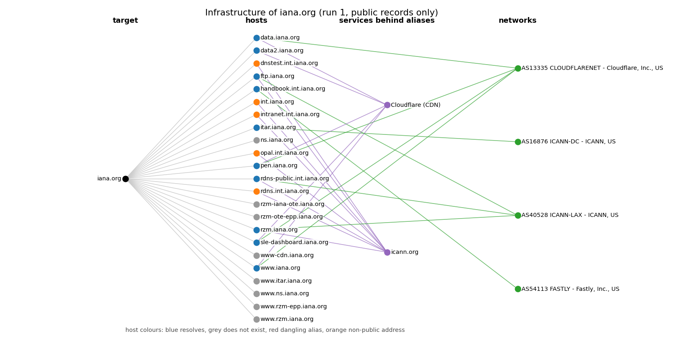

# osint-platform

A **passive OSINT platform for organisations**. Give it a domain name and it collects what the public record already says about it (certificate transparency,
RDAP, DNS, the Internet Archive's index, public GitHub organisation metadata, the target's own `robots.txt` / `security.txt` / `sitemap.xml`), keeps every claim
together with the evidence it came from, turns the records into findings, and can compare two runs to show what changed. No dependencies beyond the Python
standard library (matplotlib only for the optional graph).

```
$ osint tara iana.org --amac "checking our own external footprint" --github-org iana-org
  ct: ok - 25 names and 2 wildcard zones from 205 certificates via crt.sh
  rdap: ok - 11 facts from https://rdap.publicinterestregistry.org/rdap/
  wayback: partial - 5000 archived URLs on 2 hosts; 0 with paths worth a look; truncated at 5000
  web: ok - 1 facts from iana.org, www.iana.org
  github: ok - iana-org: 9 of 9 public repositories
  dns: ok - 25 names, 81 queries
Calisma 1 tamamlandi: 25 ad, 26 adres, 4 ag; bulgu: 0 orta, 2 dusuk, 4 bilgi.
```

## Scope and ethics: what it is for, and what it refuses to do

This is a tool for looking at **organisations through public infrastructure records**, for example your own external footprint, a supplier, or a domain you are
authorised to assess. It is deliberately built so that it cannot be turned into a tool for profiling people:

* **The only valid target is a domain.** E-mail addresses, personal names, IP addresses (devices that may belong to individuals), URLs, ports, wildcards, private
  and special-use names (`.local`, `.internal`, `.test`, ...) and public suffixes (`co.uk`) are refused, with the reason, **before any request is made**.
* **There is no module that looks at a person**: no username search, no social-media lookup, no e-mail harvesting, no breach lookup, no commit-author mining.
* **Personal data is removed on arrival, not later.** Every response is rebuilt from an allowlist of the fields the collector reads before it is cached, hashed,
  stored or parsed: RDAP registrant, administrative, technical and abuse contacts never survive; crt.sh `common_name` (on S/MIME certificates a person's name)
  and e-mail lines are dropped; GitHub owner objects and e-mail are dropped; archived URLs lose their query strings; any e-mail address that remains in text is replaced by
  `<mailbox at domain>` (the mail domain is infrastructure, the mailbox is not). The one exception is the contact an organisation publishes in `security.txt`, which
  exists to be used.
* **Every run needs a stated purpose** (`--amac`), recorded with the run.
* **Nothing is scanned, crawled or probed.** Only public indexes and APIs are read, plus one plain GET each for the target's own `robots.txt`, `security.txt` and
  `sitemap.xml`. No page is fetched, no historic URL is visited, no names are guessed or brute-forced: DNS is asked only about names that other sources revealed.
* Requests carry an identifying User-Agent, retry politely, and are cached.

Passive does not mean "anything goes": use it on assets you are responsible for or are authorised to assess, and follow the terms of the services it reads. This is
not legal advice.

## Quick start

```bash
pip install -e ".[dev]"                     # Python >= 3.9, no runtime dependencies

osint kaynaklar                             # the sources, what each reads and what it does not
osint tara example.org --amac "inventory of our own external footprint" --github-org example
osint rapor --hedef example.org             # Markdown report (--bicim json for tools, --cikti FILE to save)
osint tara example.org --amac "monthly re-check"      # a second run ...
osint fark --hedef example.org              # ... and what changed between the last two runs
osint kanit --hedef example.org --varlik 192.0.2.7    # the evidence URL and stored-response hash behind a claim
osint graf --hedef example.org --png graph.png
osint dogrulama                             # 13 validation experiments, offline
pytest                                      # 166 tests, offline (loopback only)
```

Command-line tokens are ASCII-transliterated Turkish (`tara` = scan/collect, `rapor` = report, `fark` = difference, `kanit` = evidence, `amac` = purpose, `hedef` =
target) and the output is Turkish; the code, the report and this README are English. The database defaults to `./osint.db` (`--db FILE`).

## What it collects

| source | reads | notes and limits |
|---|---|---|
| `ct` | certificate transparency: crt.sh, fallback Cert Spotter | every host name on a publicly logged certificate under the domain, with first/last validity and issuers; wildcard zones are recorded as zones, not hosts. Cert Spotter's free API lists only certificates that are still valid, so a run that fell back says so and misses hosts known only from expired certificates |
| `rdap` | IANA bootstrap, then the registry's RDAP server | registration, expiry and last-change dates, status, registrar (name and IANA id), name servers, DNSSEC. No contacts. Some TLDs publish no RDAP: reported as unavailable |
| `dns` | DNS over HTTPS (Cloudflare, fallback Google) and Team Cymru's DNS-based ASN service | A/AAAA with the whole CNAME chain, NXDOMAIN, MX, NS, TXT, CAA at the apex, `_dmarc` and `_mta-sts`; the autonomous system of every public address (IPv4 and IPv6). Private addresses are never sent to the ASN service |
| `wayback` | the Internet Archive's CDX index | archived hosts and URLs whose *path* suggests an admin page, a VCS or env file, a backup or dump, an API, a config file or a pre-production host: reported as *candidates*, never visited. The index is read in URL order, so on a very large apex site the row limit (5000) can crowd out subdomains: the status says `partial` |
| `web` | the target's own `robots.txt`, `security.txt`, `sitemap.xml` on the apex and `www` | one GET each |
| `github` | public organisation and repository metadata | only with an explicit `--github-org` (never guessed from the domain: that would attribute someone else's organisation); records whether the organisation's profile links back to the domain |

## How it works

```
 ct  rdap  wayback  web  github        run side by side, each source failing on its own
   \   |     |      |    /
    names revealed by certificates, the archive and the sitemap
                 |
                dns      (A/AAAA/CNAME chain, NXDOMAIN, MX/NS/TXT/CAA, ASN per address)
                 |
   observations in SQLite: (subject, predicate, object) + evidence URL + SHA-256 of the stored response
                 |
   snapshot  ->  findings  ->  Markdown / JSON report, graph, diff between runs
```

* **Provenance.** Every observation carries the URL it was read from and the hash of the stored (redacted) response, so any line of a report can be traced to bytes
  (`osint kanit`). The stored hash is the hash of what is stored: after redaction, not the server's original bytes.
* **Failures are statuses, never crashes and never silence.** A flaky source is retried; crt.sh down falls back to Cert Spotter; one resolver down falls back to the
  other (their TXT formats differ and both are parsed); a source that stays down is reported as `error` or `partial` in the report's "Sources and gaps" table, and the
  rules that depend on it stay silent (no claim that security.txt is missing when the fetch failed).
* **Findings are reasons to look, never verified vulnerabilities.** Severities are modest (info, low, medium) because every rule works from public records alone:
  dangling aliases (medium on providers where a released name can often be claimed, low otherwise), non-public addresses in public DNS, domain expiry, SPF and DMARC
  weaknesses, missing CAA / MTA-STS / DNSSEC / security.txt, expired security.txt, wildcard certificates, names that are in certificates but gone from DNS, sensitive-looking
  `robots.txt` paths and archived paths, and an unlinked GitHub organisation.
* **Third-party inventory.** MX, NS, SPF includes, TXT verification tokens and CNAME targets are matched against short curated lists of mail, DNS, CDN and SaaS
  providers: a picture of the supply chain, not an exhaustive one.

## How it is validated

Nothing is checked only against itself. The platform ships a **planted-truth world**: a real local HTTP server that speaks each source's response format (crt.sh,
Cert Spotter, DNS-over-HTTPS in both resolvers' dialects, RDAP, the CDX index, the GitHub API and the target's own web server) and serves a made-up organisation,
`planted-corp.org`, whose whole structure is known, built with the traps the real data contains. It also ships a **cassette**: the real responses of a live
investigation of `iana.org` recorded on 2026-10-14 (e-mail addresses scrubbed), replayed with no network. `osint dogrulama` runs 13 experiments and `pytest` 166 tests,
all offline.

| what | checked against | result |
|---|---|---|
| host inventory | the 14 planted hosts (3 only in certificates, 1 only in the archive, 1 only in a sitemap) | precision 1.00, recall 1.00 |
| scope | other tenants on shared certificates, a lookalike domain that ends with the same letters, a domain that contains the name | 0 stored, not even in the kept raw responses |
| DNS, ASN | planted records, planted prefixes (IPv4 and IPv6) | 0 wrong; private (RFC 1918) addresses never sent to the ASN service |
| dangling aliases | 1 alias to a released GitHub Pages name, 1 to an unknown vendor, 3 names that simply do not exist | 1 medium, 1 low, no false accusation |
| archive candidates | 7 planted paths, plus traps: a public `tool.tar.gz`, `?ref=partner.dev`, `/.git/config` | all found with the right categories; traps not flagged |
| privacy | 12 planted personal strings (registrant/admin/tech contacts, abuse mailbox, GitHub e-mail and a free-text field, a TXT address, an S/MIME address) | 0 stored; the only address in the database is the published security.txt contact |
| provenance | every claim looked up in the stored bytes behind its evidence URL | 46 of 46 (10 claim kinds) |
| diff | a second world with a known set of changes (new host, moved IP, removed alias, new MX, new registrar, new archived path, new repository, renewed security.txt) | exactly those, nothing spurious |
| outages | crt.sh down, both CT sources down, primary resolver down, both resolvers down, a slow site, GitHub rate-limited, a TLD without RDAP | run always completes; every failure is a status |
| real data (iana.org) | Cert Spotter's names against crt.sh's, on the real responses | Cert Spotter's 11 names are a subset of crt.sh's 25; every one has a certificate still valid at recording time and every crt.sh-only name has only expired ones |
| politeness | every request | identified User-Agent, only the planned sources, no guessed names |
| the HTTP client | a real local server: retries with exponential back-off, `Retry-After`, timeouts, size cap, per-host interval, cache, allow-list | all as specified |

### What the validation caught during development

* **The privacy design leaked.** My first redactor removed known-bad fields (`email`, `twitter_username`); a planted `Alice Maintainer` in a field it had never heard of
  survived into the stored GitHub JSON. Redaction is now an allowlist per source. Then the raw crt.sh body turned out to still contain other organisations' domains from
  multi-tenant certificates (filtered in the observations but not in the kept evidence): the redactors are now scope-aware. Archived URLs lose their query strings.
* **The HTTP cache and its clock disagreed**: entries were stamped with the client's injected clock and read back with the wall clock, so with an injected clock nothing
  was ever served from cache.
* **A nested function that used `lines +=`** would have raised `UnboundLocalError` the first time a diff was rendered (caught by pyflakes before it ever ran).
* **The issuer parser split `O="GoDaddy.com, Inc."` at the comma** and reported the issuer as `"GoDaddy.com` (found by reading the live report); it is now a proper
  distinguished-name parser.
* **Two false positives in the archive rules, from real data**: `?ref=bojana.dev` matched "pre-production" through the query string, and IANA's public `tzdata.tar.gz`
  downloads matched "backup". Patterns now look at the path only and archives only when the file name says backup, site, db or www.
* **A "real" limitation found the hard way**: the CDX index is read in URL order, so on a big apex site the 5000-row cap hides subdomains. A server-side regex filter to
  skip the apex timed out (HTTP 504 after 60 s), so the limit is reported as `partial` rather than worked around.
* My own planted truth was incomplete once (an S/MIME certificate also names `smime.planted-corp.org`, which the pipeline correctly found) and my first test baseline was
  not quiet (it triggered unrelated findings). The platform was right both times.

## Example

[`examples/report-iana.org.md`](examples/report-iana.org.md) and [`examples/report-iana.org.json`](examples/report-iana.org.json) were generated by replaying the
recorded real investigation (`python tools/make_examples.py`). Among other things it shows IANA's `*.int.iana.org` names resolving to private addresses (a leftover
visible to everyone), a monitor-only DMARC policy, 8 certified names that no longer exist, the CDN/hosting split across Cloudflare, Fastly and ICANN's own networks, and the
registration facts, with the gaps (a truncated archive read, no security.txt) listed in the report itself.



## Limitations

* **Passive public records only.** It finds what the records show: certificate transparency lists hosts that had a public certificate (internal-only and wildcard-covered
  hosts are invisible), DNS is asked only about discovered names, the archive covers what the Internet Archive crawled. Absence of a finding is not evidence of safety.
* **Findings are candidates.** A dangling alias is DNS evidence, not a confirmed takeover; archived paths are not visited and may be long gone; third-party detection uses
  short curated lists.
* **Public suffix handling is best effort**: the standard library has no public suffix list, so a short built-in list catches the common second-level suffixes.
* **Third-party services can change or limit**: crt.sh is a community service with no SLA, Cert Spotter's free tier covers only valid certificates, the GitHub API is
  rate-limited (set `GITHUB_TOKEN` for more), RDAP coverage varies by TLD and registrars redact heavily.
* **DNS answers are trusted as the resolver gives them**: the platform does no DNSSEC validation of its own.
* The real-data validation covers one domain's recording; the planted world covers the structure it was built with, not every way the internet can look.

## Project layout

```
src/osint_platformu/
    guard.py redact.py                         scope policy, privacy at ingestion
    http.py store.py model.py context.py       polite HTTP client, SQLite with provenance, data model
    sources/ ct.py dns.py rdap.py wayback.py wellknown.py github.py
    engine.py snapshot.py insights.py fingerprints.py diff.py report.py plots.py cli.py
    fakeworld.py cassette.py checks.py         the planted-truth world, record/replay of real data, the validation battery
    data/iana.org.cassette.json.gz             the recorded real investigation
tests/  tools/record_cassette.py  tools/make_examples.py  examples/
```

CI (GitHub Actions): Python 3.9, 3.12 and 3.13, fully offline.

## References

* RFC 6962 / RFC 9162 (certificate transparency), RFC 7480-7484 (RDAP), RFC 9116 (security.txt), RFC 7208 (SPF), RFC 7489 (DMARC),
  RFC 8461 (MTA-STS), RFC 8659 (CAA), RFC 1918 (private addresses).
* The JSON DNS-over-HTTPS APIs of Cloudflare and Google; Team Cymru IP-to-ASN mapping service (DNS interface); Internet Archive CDX server API.

## License

MIT
